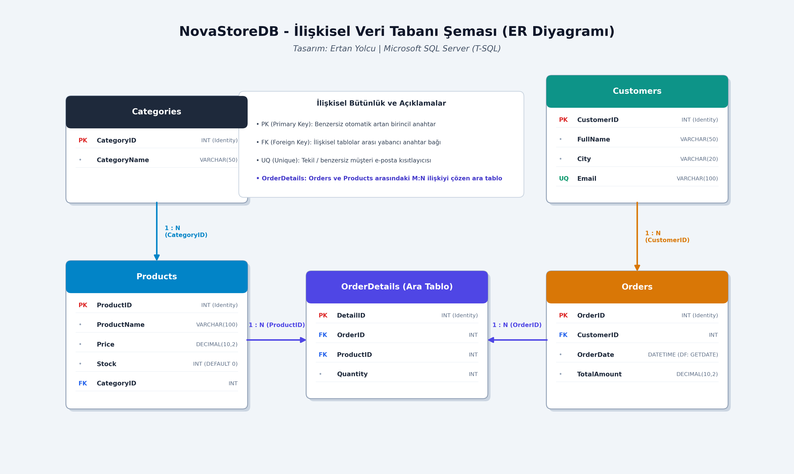

#  NOVASTORE — E-Ticaret Veri Yönetim ve Analiz Sistemi

<p align="left">
  
  
  
  
  
  
</p>

> **5 Günlük SQL Eğitimi — Bitirme Projesi & DBA Teknik Yönetim Raporu**  
> Bu proje; yeni kurulan **NovaStore** e-ticaret platformunun veri tabanı yöneticisi (DBA) olarak, ilişkisel veri modelinin sıfırdan tasarlanması (DDL), test ve analiz verilerinin girilmesi (DML), yönetim kurulu için karar destek sorgularının (DQL) hazırlanması, View ve Backup gibi kurumsal veri tabanı nesnelerinin oluşturulmasını kapsayan uçtan uca bir Microsoft SQL Server projesidir.

---

##  Proje Genel Bakış ve Kazanılan Yetkinlikler

Bu projede eğitim yönergesi kapsamındaki tüm aşamalar ve kurumsal DBA standartları eksiksiz olarak hayata geçirilmiştir:

-  **BÖLÜM 1 (DDL & Veri Tabanı Mimarisi):** `NovaStoreDB` veri tabanının oluşturulması, 5 ilişkisel tablonun (`Categories`, `Customers`, `Products`, `Orders`, `OrderDetails`) bağımlılık sırasına uygun tasarımı, `PRIMARY KEY (IDENTITY)`, `FOREIGN KEY`, `UNIQUE`, `NOT NULL` ve `DEFAULT` kısıtlayıcıları.
-  **BÖLÜM 2 (DML & Dummy Data):** 5 Kategori, farklı fiyat/stok seviyelerine sahip 13 Ürün, 6 Müşteri, geriye dönük farklı tarihlere yayılan 10 Sipariş ve 14 Sipariş Detayı ile gerçekçi test veri setinin oluşturulması.
-  **BÖLÜM 3 (DQL & İş Analitiği):** Stok filtreleme, 2'li ve 5'li `INNER JOIN`, kategori envanteri için `LEFT JOIN & COUNT`, müşteri ciro analizi için `SUM & GROUP BY` ve zaman analitiği için dinamik `DATEDIFF(DAY, OrderDate, GETDATE())` sorguları.
-  **BÖLÜM 4 (İleri Seviye Veri Tabanı Nesneleri):** Raporlama optimizasyonu için `vw_SiparisOzet` görünümü (VIEW) ve felaket kurtarma için kurumsal `BACKUP DATABASE` betiği.
-  **Kurumsal SSMS Teslimat Seti:** Tek parça SQL betiği, SSMS arayüz ekran görüntüleri, Markdown kod kutuları ve detaylı analiz açıklamalarını barındıran Word raporu (`.docx`) ile SSMS Database Diagrams ilişkisel şeması (`.png`).

---

##  İlişkisel Veri Tabanı Şeması (SSMS Database Diagram)

Aşağıda **NovaStoreDB** veri tabanının SQL Server Management Studio (SSMS) Database Diagrams arayüzünde oluşturulan ilişkisel mimarisi, Primary Key (PK) ve Foreign Key (FK) bağlantıları yer almaktadır:

<p align="center">
  
</p>

### İlişkisel Bütünlük Kuralları:
1. `Categories (1) ───< (N) Products` : Her ürün yalnızca 1 kategoriye aittir; bir kategoride birden fazla ürün bulunabilir.
2. `Customers (1) ───< (N) Orders` : Her sipariş kayıtlı 1 müşteriye aittir; bir müşteri zamanla birden fazla sipariş verebilir.
3. `Orders (1) ───< (N) OrderDetails >─── (1) Products` : Siparişler ve Ürünler arasındaki çoka-çok (N:M) ilişki, `OrderDetails` ara tablosu ile iki adet bire-çok (1:N) ilişkiye dönüştürülmüştür.

---

##  Proje Dizin Yapısı

```
ErtanYolcu_NovaStore_Proje/
├── ErtanYolcu_NovaStore_Proje.sql    # DDL, DML, DQL, View ve Backup içeren tek ana T-SQL dosyası
├── ErtanYolcu_NovaStore_Proje.docx   # SSMS ekran kanıtları ve açıklamalı Word teslim raporu
├── ErtanYolcu_NovaStore_Proje.png    # SSMS Database Diagrams ilişkisel şema ekran görüntüsü
├── screenshots/                      # SQL Server Management Studio (SSMS) sorgu ve sonuç kanıtları
│   ├── ssms_database_diagram.png     # SSMS Veri tabanı diyagramı
│   ├── ssms_q1_stock.png             # Stok < 20 temel listeleme arayüz çıktısı
│   ├── ssms_q2_join.png              # Müşteri & sipariş INNER JOIN çıktısı
│   ├── ssms_q3_multi_join.png        # Ahmet Yılmaz 5'li JOIN sepet detay çıktısı
│   ├── ssms_q4_group_by.png          # Kategori envanteri LEFT JOIN & COUNT çıktısı
│   ├── ssms_q5_revenue.png           # Ciro analizi SUM & GROUP BY çıktısı
│   ├── ssms_q6_datediff.png          # Zaman analizi DATEDIFF çıktısı
│   └── ssms_view.png                 # vw_SiparisOzet VIEW sorgu çıktısı
├── README.md                         # Kapsamlı proje dokümantasyonu ve mimari kılavuz
└── .gitignore                        # Git dışlama kuralları
```

---

##  BÖLÜM 3: Analitik Sorgu ve Raporlama Matrisi

Yönetim kurulunun karar destek süreçleri için hazırlanan 6 temel analitik rapor ve elde edilen veritabanı sonuçları:

| # | Rapor Başlığı | Kullanılan SQL Teknikleri | Elde Edilen Analitik Çıktı / Yönetici Özeti |
| :-: | :--- | :--- | :--- |
| **01** | **Kritik Stok Raporu** | `SELECT`, `WHERE`, `ORDER BY DESC` | Stok adedi 20'nin altında kalan **7 kritik ürün** listelendi. En düşük stoklu ürün: *Deri Ceket (5 Adet)*. |
| **02** | **Müşteri Sipariş Raporu** | `INNER JOIN (Customers, Orders)` | 10 siparişin müşteri adı, şehir, sipariş tarihi ve fatura toplamı kronolojik sırada listelendi. |
| **03** | **Sepet Detayı (Ahmet Yılmaz)** | `5 Tablolu Zincirleme JOIN` | Ahmet Yılmaz'ın aldığı *Akıllı Saat Pro*, *Kablosuz Kulaklık (x2)* ve *Slim Fit Jean* ürünleri ve kategorileri raporlandı. |
| **04** | **Kategori Envanter Raporu** | `LEFT JOIN`, `COUNT()`, `GROUP BY` | Kategorilerdeki çeşit sayıları: *Elektronik (3)*, *Giyim (3)*, *Kitap (3)*, *Kozmetik (2)*, *Ev ve Yaşam (2)*. |
| **05** | **Ciro Analizi (VIP Müşteri)** | `SUM()`, `GROUP BY`, `ORDER BY DESC` | Şirkete en çok ciro kazandıran müşteriler: **Ahmet Yılmaz (6.950 TL)** ve **Fatma Şahin (3.800 TL)**. |
| **06** | **Zaman Analizi (Geçen Gün)** | `DATEDIFF()`, `GETDATE()` | Sipariş tarihlerinden bugüne geçen gün dinamik hesaplandı (Bugün teslim edilen 0 gün, en eski sipariş 45 gün). |

---

##  BÖLÜM 4: İleri Seviye Veri Tabanı Nesneleri

### 1. Sipariş Özet Görünümü (`VIEW`)
Sürekli uzun ve maliyetli JOIN ifadeleri yazılmasını engellemek amacıyla oluşturulan sanal tablo:
```sql
CREATE VIEW dbo.vw_SiparisOzet
AS
SELECT 
    c.FullName AS [Müşteri Adı],
    CONVERT(VARCHAR(19), o.OrderDate, 120) AS [Sipariş Tarihi],
    p.ProductName AS [Ürün Adı],
    od.Quantity AS [Adet]
FROM dbo.Customers AS c
INNER JOIN dbo.Orders AS o ON c.CustomerID = o.CustomerID
INNER JOIN dbo.OrderDetails AS od ON o.OrderID = od.OrderID
INNER JOIN dbo.Products AS p ON od.ProductID = p.ProductID;
GO

-- Kullanımı:
SELECT * FROM dbo.vw_SiparisOzet;
```

### 2. Tam Veri Tabanı Yedeği (`BACKUP DATABASE`)
Veri güvenliği ve felaket kurtarma (Disaster Recovery) için T-SQL komutu:
```sql
BACKUP DATABASE NovaStoreDB
TO DISK = 'C:\Yedek\NovaStoreDB.bak'
WITH 
    FORMAT,
    MEDIANAME = 'NovaStoreDBBackup',
    NAME = 'Full Backup of NovaStoreDB';
GO
```

---

##  Kurulum ve Çalıştırma Rehberi

### SQL Server Management Studio (SSMS) ile Çalıştırma

1. **SSMS'i Başlatma:** SQL Server Management Studio uygulamasını açın ve SQL Server Instance'ınıza bağlanın.
2. **Scripti Açma:** `ErtanYolcu_NovaStore_Proje.sql` dosyasını SSMS içerisine sürükleyip bırakın veya `File -> Open -> File` menüsünden açın.
3. **Tek Seferde Çalıştırma:** Araç çubuğundaki **Execute** butonuna tıklayın (veya klavyeden `F5` tuşuna basın).
4. **Sonuçları İnceleme:** Betik; `NovaStoreDB` veri tabanını, tabloları, ilişkisel kısıtlayıcıları, tohum test verilerini, analitik sorguları ve `vw_SiparisOzet` görünümünü sırasıyla otomatik olarak oluşturup sonuçları **Results** ızgarasında listeleyecektir.

---

##  Temiz Kod ve Tasarım Standartları

- **Conventional Commits:** Git geçmişinde `feat(ddl)`, `feat(dml)`, `feat(dql)`, `feat(objects)`, `docs:` standartlarına tam uyum.
- **İsimlendirme Standartları (Naming Conventions):** Kısıtlayıcılar için kurumsal ön ekler (`PK_`, `FK_`, `UQ_`, `DF_`).
- **Veri Tipi Hassasiyeti:** Parasal değerler için `DECIMAL(10,2)`, zaman için `DATETIME`, metinler için boyutlandırılmış `VARCHAR`.
- **Referans Bütünlüğü (Referential Integrity):** Yabancı anahtar ilişkilerinde önce ana tabloların oluşturulması kuralı.

---

<p align="center">
  <b>Geliştirici:</b> <a href="https://github.com/ertandev">Ertan Yolcu</a> &nbsp;|&nbsp; 
  <b>Yıl:</b> 2026 &nbsp;|&nbsp; 
  <b>Lisans:</b> MIT
</p>
